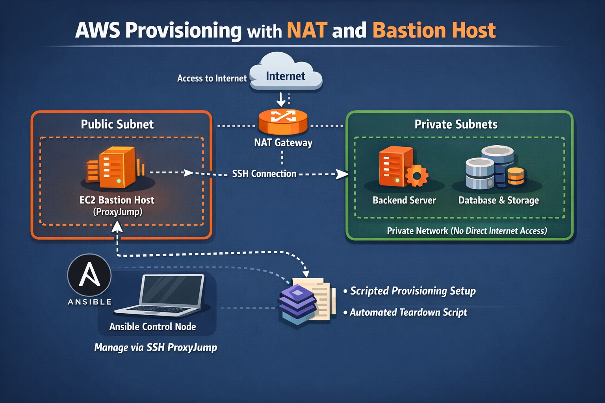

# PE2 AWS DEPLOYMENT EXTRA QUICK START

This guide is for the AWS Academy deployment extra only. The core assignment requirements are evaluated against the local Vagrant environment in `local-deploy/`.

> **Run all commands in this document from the repository root, not from inside the `provisioning/` directory.**
> The scripts write generated files to the current working directory, which must be the repo root so that Ansible picks them up correctly.

## Files

All provisioning files are located in the `provisioning/` directory:

- `provisioning/provision_pe2_nat_bastion.sh`
- `provisioning/teardown_pe2_nat_bastion.sh`



## What the provisioning script creates

AWS resources:

- 1 public frontend machine
- 1 private backend machine
- 1 private storage machine
- a VPC with public and private subnets
- a NAT Gateway for outbound internet access from the private subnet

Local files written to the repository root:

- `inventory.ini` - Ansible inventory with ProxyJump configured for the private machines
- `ansible.cfg` - Ansible configuration pointing to the inventory
- `provisioned_vars.yml` - generated IP addresses and region for use in your Ansible vars
- `pe2_state.env` - resource IDs used by the teardown script

These files are generated and must not be committed. They are already covered by the repository's `.gitignore`.

## Before you start

Make sure the following are already available on your machine:

- AWS CLI installed and configured
- an existing SSH key pair on your machine
- Bash
- Ansible

Example check:

```bash
aws sts get-caller-identity
ssh -V
ansible --version
```

If you do not already have an SSH key pair, create one:

```bash
ssh-keygen -t ed25519 -f ~/.ssh/id_ed25519
```

## Provision the machines

Make the scripts executable:

```bash
chmod +x provisioning/provision_pe2_nat_bastion.sh provisioning/teardown_pe2_nat_bastion.sh
```

Run provisioning:

```bash
./provisioning/provision_pe2_nat_bastion.sh
```

If your public key is not `~/.ssh/id_ed25519.pub`, provide it explicitly:

```bash
KEY_PUB=~/.ssh/your_key.pub ./provisioning/provision_pe2_nat_bastion.sh
```

If automatic public-IP detection does not work, provide your SSH source CIDR manually:

```bash
SSH_CIDR=203.0.113.10/32 ./provisioning/provision_pe2_nat_bastion.sh
```

## If provisioning fails

If the script exits with an error partway through, some AWS resources may have been created before the failure.

Run the teardown script to clean up:

```bash
./provisioning/teardown_pe2_nat_bastion.sh
```

If the teardown script cannot find the state file, check the AWS console manually and remove any resources tagged with your project tag before retrying.

Do not run the provisioning script again while `pe2_state.env` still exists. The script will refuse to start if a state file is present.

## Files generated by the provisioning script

After provisioning, the script writes the following files to the **repository root**:

- `inventory.ini`
- `ansible.cfg`
- `provisioned_vars.yml`
- `pe2_state.env`

These files are generated and must not be committed. They are already covered by the repository's `.gitignore`.

## Test Ansible connectivity

Run:

```bash
ansible all -m ping
```

The backend and storage machines are reached through the frontend using SSH ProxyJump.

Once all three hosts respond successfully, provisioning is complete. You are ready to run your Ansible deployment playbook.

## Connect manually

Connect to the frontend directly:

```bash
ssh -i ~/.ssh/id_ed25519 ec2-user@FRONTEND_PUBLIC_IP
```

## Tear everything down

When you are finished, destroy all created AWS resources:

```bash
./provisioning/teardown_pe2_nat_bastion.sh
```

This uses the `pe2_state.env` file written during provisioning.

## Important notes

This setup uses a NAT Gateway and an Elastic IP. In AWS Academy, this may consume quota or budget and may be blocked by lab permissions.

All three EC2 instances use `t3.micro` (1 GiB RAM). This is sufficient for demo workloads with minimal data, but keep resource usage in mind when choosing storage technologies or implementing extras that add services such as a central logging component. Memory-intensive services on a 1 GiB instance can cause OOM kills under load.

You can use a larger instance type if required.

The generated `ansible.cfg` disables `host_key_checking`. This is intentional for a lab environment where EC2 host keys change on every provision. Do not copy this setting into production configurations.

The backend and storage machines are in the private subnet. Ansible reaches them through the frontend machine as a ProxyJump bastion. If a frontend redeploy breaks SSH access, you will also lose Ansible connectivity to the backend and storage until the frontend is recovered. Avoid reconfiguring or restarting `sshd` on the frontend without careful testing.

The file `provisioned_vars.yml` contains the IP addresses and region written by the provisioning script. Use it as a reference when populating your Ansible `group_vars` or `host_vars`. Do not copy it into your playbook directory unchanged — it is a hint file, not an Ansible variables file.
